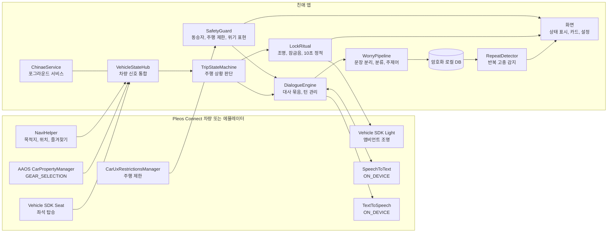
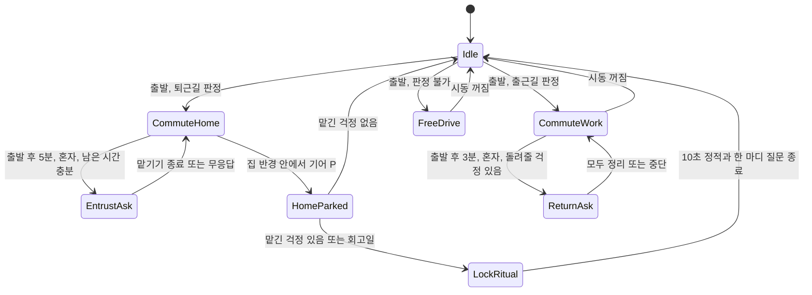
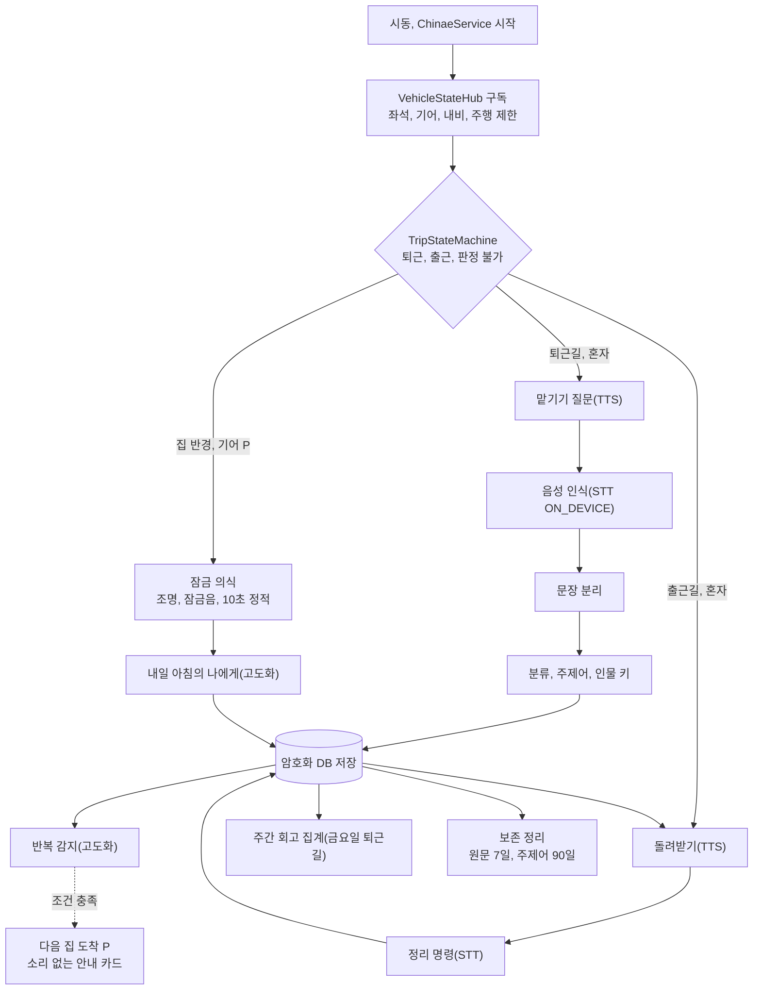

# 친애(親愛) Masterplan

> 현대자동차그룹 차량용 앱 개발 공모전(Pleos Connect) 출품작 친애의 기술 설계와 개발부터 제출까지의 파이프라인을 한 문서로 정리함
>
> - 작성일: 2026-11-07
> - 기준 문서: 접수양식 v3(기획서), Pleos Playground 개발 문서(SDK 릴리스 2026-10-19 기준), 공모전 공식 안내
> - 표기: **[확인 필요]** 는 공개 문서만으로 확정하지 못해 에뮬레이터 실행이나 공식 답변으로 확인할 항목, **[초기값]** 은 설계상 정한 값으로 테스트 후 조정할 항목임
> - 공개 저장소에 올릴 때 성명, 연락처, 소속이 들어가지 않도록 이 문서에는 개인정보를 적지 않음

---

## 목차

- [0. 한눈에 보기](#0-한눈에-보기)
- **Part A. 기술 문서**
  - [1. 제품 개요와 설계 원칙](#1-제품-개요와-설계-원칙)
  - [2. 시스템 아키텍처](#2-시스템-아키텍처)
  - [3. 주행 상황 판단](#3-주행-상황-판단)
  - [4. 대화 설계](#4-대화-설계)
  - [5. 걱정 나누기와 반복 고충 감지](#5-걱정-나누기와-반복-고충-감지)
  - [6. 데이터 모델과 보존 정책](#6-데이터-모델과-보존-정책)
  - [7. SDK와 API 매핑, 권한](#7-sdk와-api-매핑-권한)
  - [8. 안전과 주행 제한](#8-안전과-주행-제한)
  - [9. 개인정보와 보안](#9-개인정보와-보안)
  - [10. 예외 처리와 폴백](#10-예외-처리와-폴백)
  - [11. 테스트 계획](#11-테스트-계획)
- **Part B. 파이프라인**
  - [12. 런타임 처리 파이프라인](#12-런타임-처리-파이프라인)
  - [13. 개발과 빌드 파이프라인](#13-개발과-빌드-파이프라인)
  - [14. 제출과 심사 파이프라인](#14-제출과-심사-파이프라인)
  - [15. 리스크와 결정 게이트](#15-리스크와-결정-게이트)
  - [16. 미결 사항](#16-미결-사항)
  - [17. 참고 자료](#17-참고-자료)

---

## 0. 한눈에 보기

| 항목 | 내용 |
| --- | --- |
| 앱 | 친애(親愛), 퇴근길에 맡긴 걱정을 밤새 맡아 두었다가 다음 날 출근길에 돌려주는 차 안의 말수 적은 오랜 친구 |
| 대상 플랫폼 | Pleos Connect(AAOS 기반), 개발은 Pleos Connect Emulator 2.1.0과 Virtual Console |
| 핵심 차량 신호 | 좌석별 탑승 여부, 기어 P 전환, 내비 목적지와 남은 시간, 앰비언트 조명, 차량 마이크와 스피커 |
| 1차 제출 범위(MVP) | 맡기기, 잠금 의식, 돌려받기 음성 흐름, 걱정 나누기, 말투 설정 |
| 고도화 범위(2차 PT 전) | 주간 회고, 기억하는 친구, 반복 고충 연결, 내일 아침의 나에게, 호칭 확인, 위기 표현 안내, 차종별 분기 |
| 핵심 일정 | 1차 제출 2026-11-15 23:59, 1차 결과 11-23, 2차 PT 12-03~04, 최종 발표 12-18 |
| 가산점 산출물 | 시연 영상, GitHub 저장소(소스와 APK) |

---

# Part A. 기술 문서

## 1. 제품 개요와 설계 원칙

### 1.1 기능 정의

| 번호 | 기능 | 동작 시점 | 요약 | 범위 |
| --- | --- | --- | --- | --- |
| ① | 맡기기 | 퇴근길 주행 중, 운전자 혼자일 때 | 오늘 두고 가고 싶은 걱정을 음성으로 받아 문장 단위로 저장 | MVP |
| ② | 잠금 의식 | 집 위치에서 기어 P | 조명 전환, 잠금음, 10초 정적, 내일 아침의 나에게 한 마디 질문 | MVP(한 마디는 고도화) |
| ③ | 돌려받기 | 다음 출근길 | 맡긴 걱정을 한 건씩 들려주고 해결됨, 오늘 처리, 내려놓기로 정리 | MVP |
| ④ | 주간 회고 | 금요일 퇴근길 | 이번 주 맡긴 걱정 중 다시 꺼낼 필요가 없었던 비율 안내 | 고도화 |
| ⑤ | 걱정 나누기 | 저장 시점 | 할 수 있는 일과 바꿀 수 없는 일로 분류, 사용자가 음성으로 바로잡기 | MVP |
| ⑤-1 | 반복 고충 연결 | 조건 충족 후 다음 집 도착 P | 상담 창구를 소리 없이 화면 카드로 안내 | 고도화 |
| - | 기억하는 친구 | 같은 걱정 재등록, 주간 회고 | 지난 결과를 짧게 알려 줌 | 고도화 |
| - | 말투 설정 | 첫 실행, 설정 | 반말과 해요체, 한국어 화자 4명 중 선택 | MVP |

### 1.2 설계 원칙

- **조언하지 않음**: 친애는 듣고, 기억하고, 맡아 주기만 함. 상담, 해석, 훈계 문장을 대사 묶음에 넣지 않음
- **짧게 말함**: 한 번에 한 건, 한두 마디. 되묻지 않음
- **혼자일 때만 말함**: 동승자가 감지되면 먼저 말을 걸지 않음
- **정해진 순간에만 먼저 말함**: 퇴근길 1회, 집 도착 P 1회, 출근길 1회. 주말과 공휴일에는 먼저 묻지 않음
- **의존하게 만들지 않음**: 긴 대화 기능을 두지 않고, 반복 고충은 사람이 응대하는 창구로 연결
- **차 밖으로 내보내지 않음**: 맡긴 내용은 기기 안에만 암호화해 저장하고 음성 인식은 ON_DEVICE 모드 사용
- **치료 도구가 아님**: 첫 실행과 설정 화면에 습관 도구임을 안내하고, 위기 표현에는 109를 안내

---

## 2. 시스템 아키텍처

### 2.1 구성도



### 2.2 모듈 책임

| 모듈 | 책임 | 의존 |
| --- | --- | --- |
| ChinaeService | 시동 후 상주하는 포그라운드 서비스. 각 모듈 생명주기 관리 | 전체 |
| VehicleStateHub | 좌석, 기어, 내비 신호를 구독해 하나의 VehicleSnapshot 흐름으로 합침. 각 API의 capability 확인 결과 보관 | Vehicle SDK, CarPropertyManager, NaviHelper |
| TripStateMachine | 퇴근길, 출근길, 집 도착 P를 판단하고 대화 시점 이벤트 발행 | VehicleStateHub, Clock, PlaceStore |
| DialogueEngine | 말투별 대사 묶음 선택, TTS 출력, STT 결과 수신, 음성 명령 해석, 턴 수 제한 | STT, TTS, SafetyGuard |
| WorryPipeline | 발화를 문장 단위 걱정으로 나누고 분류, 주제어와 인물 키 추출 후 저장 | DB |
| RepeatDetector | 바꿀 수 없는 일 중 같은 인물이나 주제어의 반복을 감지해 안내 카드 예약 | DB |
| LockRitual | 조명 전환, 잠금음 재생, 10초 정적 타이머, 내일 아침의 나에게 질문 | Light, DialogueEngine |
| SafetyGuard | 동승자 탑승 시 발화 차단, 주행 제한 시 입력 UI 숨김, 위기 표현 감지 | VehicleStateHub, UXR |
| RetentionWorker | 원문 7일, 주제어와 결과 90일 보존 기한 정리 | DB |
| UI(Compose) | 주행 중 상태 표시, 정차 중 설정, 안내 카드, 주간 회고 화면 | ViewModel |

### 2.3 저장소 구조(계획)

```text
chinae/
├─ app/src/main/java/app/chinae/
│  ├─ service/      ChinaeService, 알림 채널
│  ├─ vehicle/      SeatSource, GearSource, NaviSource, LightController, VehicleStateHub
│  ├─ trip/         TripStateMachine, TripRules, PlaceStore
│  ├─ voice/        SpeechIn, SpeechOut, DialogueEngine, CommandParser
│  ├─ worry/        Segmenter, Classifier, KeyExtractor, RepeatDetector
│  ├─ ritual/       LockRitual
│  ├─ safety/       SafetyGuard, CrisisLexicon
│  ├─ data/         Room 엔티티, DAO, 암호화, RetentionWorker
│  └─ ui/           Compose 화면, ViewModel
├─ app/src/main/assets/dialogue/   banmal.json, haeyo.json
├─ app/src/main/res/raw/           lock_chime.ogg
├─ app/src/test/                   단위 테스트
├─ demo/                           시연용 녹음 PCM, Virtual Console 시나리오
└─ docs/                           masterplan.md, 기획서
```

패키지 이름 app.chinae는 가칭이며 제출 전 확정함

---

## 3. 주행 상황 판단

### 3.1 상태 머신



- 동승자 탑승이 감지되면 어느 상태에서든 발화를 멈추고, 진행 중인 대화는 저장 후 종료함
- 기어가 P에서 벗어나거나 동승석 탑승이 감지되면 잠금 의식을 즉시 끝냄

### 3.2 판정 규칙

| 판정 | 1순위 신호 | 2순위 폴백 | 비고 |
| --- | --- | --- | --- |
| 퇴근길 | 내비 목적지가 집 | 출발 위치가 회사 반경 안이고 15시~24시 출발 | 시간대 [초기값] |
| 출근길 | 내비 목적지가 회사 | 출발 위치가 집 반경 안이고 5시~12시 출발 | 시간대 [초기값] |
| 혼자 탑승 | 운전석 외 모든 좌석 탑승 false | capability 미지원 시 정차 중 화면에서 1회 확인 | 3.4 참고 |
| 집 도착 | 현재 위치가 집 반경 안이고 기어 P | 내비 onDestinationArrived 후 기어 P | 반경 150m [초기값] |
| 쉬는 날 | 토요일, 일요일, 앱 내장 공휴일 목록 | 사용자가 설정에서 근무일 지정 | 먼저 묻지 않음 |

### 3.3 집과 회사 위치 등록

1. NaviHelper getBookmarkInfo로 즐겨찾기를 읽어 집과 회사 항목을 찾음 [확인 필요: 즐겨찾기 데이터에 집과 회사 구분 필드가 있는지]
2. 없으면 첫 사용 때 기어 P로 정차한 위치를 집이나 회사로 지정하도록 정차 중 화면에서 물음
3. 설정 화면에서 언제든 다시 지정 가능

### 3.4 대화 시점 파라미터

| 파라미터 | 값 | 근거 |
| --- | --- | --- |
| 맡기기 질문 시점 | 퇴근길 출발 후 5분, 목적지까지 남은 시간 8분 이상일 때 1회 | [초기값], 기획서 시나리오(출발 8분 뒤 질문)와 맞춤 |
| 돌려받기 시작 시점 | 출근길 출발 후 3분, 남은 시간 10분 이상 | [초기값] |
| 발화 1회 최대 길이 | 60초 | [초기값] |
| 무응답 판정 | 질문 후 7초 | [초기값] |
| 잠금 의식 정적 | 10초 | 기획서 고정값 |
| 내일 아침의 나에게 질문 | 정적 후 1회, 무응답이면 종료 | 기획서 |
| 출퇴근당 먼저 말 거는 횟수 | 최대 1회 | 설계 원칙 |

---

## 4. 대화 설계

### 4.1 대사 묶음

- assets/dialogue/banmal.json, haeyo.json 두 파일에 같은 키, 다른 말투로 대사를 둠
- 키 예시: ask_entrust, ack_entrust, lock_done, ask_note_to_self, greet_return, return_item, ask_today, ask_let_go, weekly_summary, alias_check, crisis_109
- 대사는 한두 문장 이내, 조언이나 평가 표현 금지. 리뷰 체크리스트로 관리
- 호칭은 설정값을 끼워 넣음. 예: 좋은 아침, {alias}

### 4.2 맡기기 흐름

```text
TTS  ask_entrust      "오늘 두고 가고 싶은 거 있으면 나한테 맡겨."
STT  사용자 발화       "내일 오전 보고서 수치가 아직 안 맞아. 그리고 팀장님 메일에 답장 못 했어."
처리 WorryPipeline    문장 분리 → 2건 저장(분류, 주제어)
TTS  ack_entrust      "두 개, 잘 맡아 둘게."
```

- 결과 건수만 말하고 내용을 되읽지 않음
- 음성 인식 결과가 비어 있으면 아무 말 없이 끝냄

### 4.3 돌려받기 흐름

```text
TTS  alias_check      호칭으로 맡긴 사람 확인(고도화). 다른 사람이라고 답하면 중단
TTS  greet_return     "좋은 아침, 민준. 어제 맡긴 거 두 개 돌려줄게."
반복 각 걱정마다
  TTS return_item     "첫 번째, 보고서 수치."
  TTS ask_today 또는 ask_let_go   분류에 따라 질문
  STT 명령            해결됨 | 오늘 처리 | 내려놓기 | 할 수 있는 일 | 바꿀 수 없는 일
종료 남긴 한 마디가 있으면 도착 직전 재생(고도화)
```

### 4.4 음성 명령 사전

| 명령 | 인식 표현 예시 | 결과 |
| --- | --- | --- |
| 해결됨 | 해결됨, 해결했어, 끝났어 | status = RESOLVED |
| 오늘 처리 | 오늘 처리, 오늘 할게, 이따 할게 | status = TODAY |
| 내려놓기 | 내려놓기, 내려놓을게, 그냥 둘래 | status = LET_GO |
| 할 수 있는 일 | 할 수 있는 일이야 | category = ACTIONABLE, corrected = true |
| 바꿀 수 없는 일 | 바꿀 수 없는 일이야 | category = UNCHANGEABLE, corrected = true |
| 그만 | 그만, 나중에 | 남은 항목 보류, 다음 출근길로 이월 |

- 인식 실패 시 같은 질문을 다시 하지 않고 다음 항목으로 넘어가며, 해당 항목은 다음 출근길로 이월함

---

## 5. 걱정 나누기와 반복 고충 감지

### 5.1 문장 분리

- STT 최종 결과를 마침표, 그리고, 또, 그리고요 같은 연결 표현 기준으로 나눔
- 5자 미만 조각은 앞 문장에 붙임

### 5.2 분류 규칙(MVP, 기기 안 규칙 기반)

| 분류 | 신호 | 예 |
| --- | --- | --- |
| 할 수 있는 일(ACTIONABLE) | 기한 표현(내일, 오전, 까지, 마감), 행동 표현(해야, 보내, 답장, 정리, 제출, 끝내), 업무 대상 명사(보고서, 메일, 자료) | 내일 오전 보고서 수치 맞춰야 함 |
| 바꿀 수 없는 일(UNCHANGEABLE) | 사람 지칭과 태도 표현의 결합(팀장님이, 거래처가 + 무리한, 왜, 서운, 짜증), 이미 지난 사건 서술 | 거래처 담당자가 또 무리하게 요구함 |
| 미분류(UNKNOWN) | 두 신호가 모두 없거나 비슷하게 섞임 | 돌려받을 때 오늘 처리할지 먼저 물음 |

- 사용자가 바로잡은 결과는 해당 주제어의 다음 분류에 우선 적용함
- 형태소 분석기 도입은 고도화 단계에서 APK 크기와 정확도를 보고 결정함 [확인 필요]

### 5.3 주제어와 인물 키

- 주제어: 조사를 떼어 낸 명사 후보 중 업무 사전에 있는 단어와 2회 이상 나온 단어
- 인물 키: 호칭 사전(팀장님, 부장님, 거래처, 고객, 동료 등)과 이름 뒤 님 패턴
- 원문은 7일 뒤 지워도 주제어, 인물 키, 정리 결과는 90일 보존해 기억하는 친구와 반복 감지에 씀

### 5.4 반복 고충 감지(고도화)

```text
조건  category = UNCHANGEABLE
      AND 같은 personKey 또는 topicKey
      AND 최근 14일 안에 3건 이상
동작  ReferralCard 예약 → 다음 집 도착 기어 P 시점에 화면 카드만 표시(소리 없음)
내용  회사 상담 프로그램(EAP)과 고충처리 창구(기업 제휴 시 등록값)
      근로복지공단 근로자지원프로그램
      고용노동부 고객상담센터 1350
제한  같은 키로는 14일에 1회만 표시, 회사로 어떤 정보도 보내지 않음
```

---

## 6. 데이터 모델과 보존 정책

### 6.1 엔티티(Room)

| 엔티티 | 주요 필드 | 비고 |
| --- | --- | --- |
| Worry | id, tripId, createdAt, rawText(nullable), rawExpiresAt, category, corrected, topicKeys, personKey, status, returnedAt, ownerAlias | rawText는 정리되거나 7일 지나면 null |
| NoteToSelf | id, createdAt, text, deliveredAt | 내일 아침의 나에게, 전달 후 삭제 |
| Trip | id, type(HOME, WORK, FREE), startedAt, endedAt, asked, aloneAtAsk | 대화 시점 조정용 |
| ReferralCard | id, triggerKey, createdAt, shownAt | 반복 고충 안내 이력 |
| Place | type(HOME, WORK), lat, lng, source(BOOKMARK, MANUAL) | 집과 회사 |
| Settings(DataStore) | tone, speaker, alias, workdays, referralContacts, onboardingDone | 말투, 화자, 호칭 |

### 6.2 상태 값

| 필드 | 값 |
| --- | --- |
| category | ACTIONABLE, UNCHANGEABLE, UNKNOWN |
| status | PENDING, RESOLVED, TODAY, LET_GO, DEFERRED |

### 6.3 주간 회고 지표

- 다시 꺼낼 필요가 없었던 비율 = 이번 주 맡긴 걱정 중 RESOLVED 또는 LET_GO로 정리된 건수 ÷ 이번 주 맡긴 건수
- 기억하는 친구 문장 = 같은 topicKey의 최근 30일 등록 횟수와 정리 결과 분포

### 6.4 보존 정책

| 데이터 | 보존 기간 | 처리 |
| --- | --- | --- |
| 원문(rawText) | 정리 즉시 또는 7일 | 필드 삭제 |
| 주제어, 인물 키, 정리 결과 | 90일 | 행 삭제 |
| 내일 아침의 나에게 | 전달 즉시 | 행 삭제 |
| 반복 안내 이력 | 90일 | 행 삭제 |
| 음성 원본 | 저장하지 않음 | STT에 넘긴 뒤 보관하지 않음 |

- RetentionWorker는 시동 시점과 하루 1회 실행함
- 설정에 모든 기록 지우기를 둠

---

## 7. SDK와 API 매핑, 권한

### 7.1 기능별 매핑

| 기능 | API | 권한 | Playground 상태 | 폴백 |
| --- | --- | --- | --- | --- |
| 혼자 탑승 판단 | Seat `checkSeatOccupancyCapabilities`, `getCurrentSeatOccupancy`, `registerSeatOccupancy` | `pleos.car.permission.CAR_SEATS` | 사용 가능 | 미지원 차량은 정차 중 화면 확인 |
| 기어 P 감지 | `CarPropertyManager` + `VehiclePropertyIds.GEAR_SELECTION`, P는 `VehicleGear.GEAR_PARK` | `android.car.permission.CAR_POWERTRAIN` | AAOS 표준 | 없음(필수) |
| 퇴근과 출근 구분, 남은 시간 | NaviHelper `getDestinationInfo`, `onDestinationInfo`, `onDestinationChanged`, DestinationInfo.remainTime | `pleos.car.permission.NAVI_ROUTE` | 사용 가능 | 출발 위치와 시간대 |
| 현재 위치, 집 도착 | NaviHelper `getCurrentLocationInfo`, `onCurrentLocationInfo`, `onDestinationArrived` | 같음 | 사용 가능 | 없음 |
| 집과 회사 위치 | NaviHelper `getBookmarkInfo`, `onBookmarkInfo` | 같음 | 사용 가능 | 첫 사용 수동 등록 |
| 보관 완료 조명 | Light `checkAmbientLightBrightnessColorCapabilities`, `setAmbientLightBrightnessColor`(32비트 ARGB) | `pleos.car.permission.CONTROL_CAR_LIGHTS`, 읽기는 `CAR_LIGHTS` | 준비 중(차량 제어) | 화면 색 전환 |
| 음성 인식 | `SpeechToText(context, Mode.ON_DEVICE)`, `initialize`, `setLocale`, `addListener`, `request`, `sendAudio`, `completeAudioSend`, `stop` | `pleos.car.permission.STT_SERVICE` | 준비 중, ON_DEVICE는 등록 없이 동작한다고 문서화 | 시연은 sendAudio로 녹음 PCM 입력 |
| 음성 합성 | `TextToSpeech(context, Mode.ON_DEVICE)`, `initialize`, `setLocale`, `setSpeakerType`, `setAudioAttributes`, `addEventListener`, `speak` | `pleos.car.permission.TTS_SERVICE` | 준비 중, ON_DEVICE 동일 | 화면 자막 |
| 주행 제한 반영 | `CarUxRestrictionsManager.onUxRestrictionsChanged` | 없음 | AAOS 표준 | 없음(필수) |

- Vehicle SDK 호출은 IPC라 결과가 onComplete, onFailed 비동기 콜백으로 옴. VehicleStateHub에서 코루틴으로 감싸고 타임아웃을 둠
- 차종마다 지원 API가 다르므로 모든 Vehicle SDK 기능은 check*Capabilities 결과로 켜고 끔
- TTS 한국어 화자는 seoyoon, eunwoo, haeun, sanghyeok 4명
- 다른 출품작 코드에서 주행 모드별 조명 자동 변경을 끄는 API(getAmbientColorAutoByDriveModeEnabled, setAmbientColorAutoByDriveModeEnabled)를 먼저 끄고 색을 바꾸는 사례가 있음 [확인 필요: 공식 문서 대조]

### 7.2 Gradle 설정

```kotlin
// settings.gradle.kts
dependencyResolutionManagement {
    repositories {
        google()
        mavenCentral()
        maven("https://nexus-playground.pleos.ai/repository/maven-releases/")
    }
}

// app/build.gradle.kts
android {
    compileSdk = 35
    defaultConfig { minSdk = 28; targetSdk = 35 }
    compileOptions { sourceCompatibility = JavaVersion.VERSION_17; targetCompatibility = JavaVersion.VERSION_17 }
}
dependencies {
    implementation("ai.pleos.playground:Vehicle:2.3.2")
    implementation("ai.pleos.playground:NaviHelper:3.0.5")
    implementation("ai.pleos.playground:SpeechToText:3.3.1")
    implementation("ai.pleos.playground:TextToSpeech:3.3.1")
}
```

- 공식 샘플 앱 기준 AGP 8.8.2, Kotlin 2.0.0, Compose 사용. 문서 기준 최소 API 28, Gradle 8.0 이상
- AAOS Car API(android.car) 사용을 위한 라이브러리 선언 방식은 샘플과 다른 출품작 설정을 보고 맞춤 [확인 필요]

### 7.3 Manifest

```xml
<uses-permission android:name="pleos.car.permission.CAR_SEATS" />
<uses-permission android:name="pleos.car.permission.CAR_LIGHTS" />
<uses-permission android:name="pleos.car.permission.CONTROL_CAR_LIGHTS" />
<uses-permission android:name="android.car.permission.CAR_POWERTRAIN" />
<uses-permission android:name="pleos.car.permission.NAVI_ROUTE" />
<uses-permission android:name="pleos.car.permission.STT_SERVICE" />
<uses-permission android:name="pleos.car.permission.TTS_SERVICE" />
<uses-permission android:name="android.permission.FOREGROUND_SERVICE" />
<!-- INTERNET 권한은 선언하지 않음(공모전 빌드) -->

<application>
    <service android:name=".service.ChinaeService"
             android:exported="false"
             android:foregroundServiceType="specialUse" />
    <activity android:name=".ui.MainActivity" android:exported="true">
        <meta-data android:name="distractionOptimized" android:value="true" />
    </activity>
</application>
```

- 필요한 권한만 선언함. App Market 출시 단계에서는 사전 승인받은 Vehicle SDK 권한만 선언할 수 있음
- STT가 앱 프로세스에서 마이크를 여는지에 따라 RECORD_AUDIO와 포그라운드 서비스 유형 microphone 필요 여부가 달라짐 [확인 필요]

---

## 8. 안전과 주행 제한

| 항목 | 설계 |
| --- | --- |
| 주행 중 화면 | 상태 표시만, 입력 요소 없음. CarUxRestrictions 변경 시 즉시 반영 |
| 주행 중 입력 | 음성만 사용 |
| 동승자 | 탑승 감지 시 먼저 말하지 않음. 대화 중 감지되면 저장 후 종료 |
| 대화 길이 | 한 번에 한 건, 한두 마디. 음성 조작 뒤에도 주의력 저하가 남을 수 있어 턴 수를 최소화 |
| 오디오 | TTS AudioAttributes를 음성 안내 용도로 지정해 미디어와 겹칠 때 볼륨 조정(덕킹) |
| 반복 고충 안내 | 소리 없이 정차(P) 중 화면 카드로만 |
| 위기 표현 | 기기 안 표현 사전으로 감지하면 짧은 음성 한 문장과 정차 시 화면 카드로 109 안내. 판단, 진단, 상담은 하지 않음 |
| 가족 공용 차량 | 돌려주기 전 호칭 확인, 다른 사람이면 돌려주지 않음(고도화) |

- 에뮬레이터 주행 규제 테스트: `adb shell cmd hmg_car_service --service drivingstate driving`(해제 명령은 Pleos adb 명령 가이드 참고)

---

## 9. 개인정보와 보안

- 맡긴 내용은 기기 안 데이터베이스에만 저장하고 외부 서버로 보내지 않음
- 데이터베이스 암호화: Room에 SQLCipher for Android를 붙이고, 키는 Android Keystore에서 생성해 감싸서 보관하는 방식으로 계획함
- 음성 인식은 ON_DEVICE 모드만 사용하고 음성 원본은 저장하지 않음
- 공모전 빌드는 INTERNET 권한을 선언하지 않음. 기업 제휴 단계에서 이용 여부만 익명 집계해 보낼 때 별도 동의와 함께 추가함
- 기업에는 개인이 맡긴 내용과 안내 여부를 제공하지 않고, 이용자 수와 이용률을 10명 이상 집단 단위로만 제공함(사업 단계)
- 로그에는 맡긴 내용을 남기지 않음. 디버그 빌드도 길이와 분류만 기록함

---

## 10. 예외 처리와 폴백

| 상황 | 감지 | 처리 |
| --- | --- | --- |
| STT 초기화 실패 | initialize onFailure, 6초 무응답 | 맡기기 질문을 하지 않음. 시연 빌드는 녹음 PCM 입력 경로 사용 |
| TTS 초기화 실패 | 같음 | 정차 중 화면 자막으로만 안내 |
| 조명 제어 미지원 | capability 결과, 쓰기 실패 | 화면 전체를 서늘한 흰빛에서 따뜻한 빛으로 전환 |
| 좌석 탑승 미지원 | capability 결과 | 정차 중 화면에서 혼자 운전하는지 1회 확인 후 해당 주행에만 적용 |
| 내비 목적지 없음 | NavigationStatus FREE_DRIVE | 출발 위치와 시간대로 판정, 판정 불가 시 대화하지 않음 |
| 집과 회사 미등록 | PlaceStore 비어 있음 | 첫 기어 P 정차 시 등록 화면 |
| 출근길 없이 이틀 경과 | 다음 출근길 판정 시 | 오래된 순서로 돌려주고, 7일 지난 항목은 주제어만 들려줌 |
| 앱 종료, 재부팅 | 서비스 재시작 | 진행 중이던 대화는 버리고 저장된 걱정만 유지 |

---

## 11. 테스트 계획

### 11.1 단위 테스트

| 대상 | 검증 내용 |
| --- | --- |
| TripRules | 목적지, 출발 위치, 시간대, 요일 조합별 퇴근과 출근 판정 |
| Segmenter | 연결 표현과 짧은 조각 처리 |
| Classifier | 분류 신호별 결과, 사용자 바로잡기 우선 적용 |
| RepeatDetector | 14일, 3건, 바꿀 수 없는 일 조건과 14일 1회 제한 |
| RetentionWorker | 시간 주입(Clock)으로 7일, 90일 경계 확인 |
| CommandParser | 명령 사전 변형 표현 인식 |

### 11.2 에뮬레이터 시나리오

Virtual Console(에뮬레이터 8088 포트를 포워딩한 뒤 PC 브라우저에서 접속)로 좌석 탑승과 기어를 바꾸고, NaviHelper 목적지는 에뮬레이터 내비에서 설정함

| 번호 | 시나리오 | 조작 | 기대 결과 |
| --- | --- | --- | --- |
| S1 | 퇴근 맡기기 | 목적지 집, 운전석만 탑승, 기어 D | 5분 뒤 1회 질문, 발화가 문장별로 저장 |
| S2 | 동승자 침묵 | S1 중 동승석 탑승 켜기 | 발화 0회, 진행 중 대화 저장 후 종료 |
| S3 | 잠금 의식 | 집 반경에서 기어 P | 조명 또는 화면 색 전환, 잠금음, 10초 정적, 한 마디 질문 |
| S4 | 출근 돌려받기 | 다음 날 목적지 회사 | 저장된 걱정을 한 건씩 재생, 명령별 상태 반영 |
| S5 | 분류 바로잡기 | S4 중 바꿀 수 없는 일이야 | category 변경, corrected = true |
| S6 | 주행 규제 | adb 주행 규제 켜기 | 입력 요소 숨김, 상태 표시만 |
| S7 | 반복 고충(고도화) | 같은 인물 걱정 3건, 14일 안 | 다음 집 도착 P에서 소리 없는 카드 |
| S8 | 호칭 불일치(고도화) | 호칭 확인에 아니라고 답함 | 돌려주지 않음 |
| S9 | 위기 표현(고도화) | 사전 표현 포함 발화 | 109 안내 1문장과 정차 시 카드 |
| S10 | SDK 미지원 | capability 실패 주입 | 10장 폴백 동작 |

### 11.3 완료 기준(1차 제출)

- S1~S6을 영상으로 끊김 없이 시연할 수 있음
- 동승자 탑승 시 발화 0회
- 출퇴근당 먼저 말 거는 횟수 1회 이하
- 크래시 없이 시동 켜기와 끄기 10회 반복

---

# Part B. 파이프라인

## 12. 런타임 처리 파이프라인



| 단계 | 입력 | 출력 | 지연 목표 |
| --- | --- | --- | --- |
| 신호 통합 | 좌석, 기어, 내비 콜백 | VehicleSnapshot | 콜백 수신 즉시 |
| 상황 판단 | VehicleSnapshot, 시각, 장소 | 상태 전환 이벤트 | 1초 이내 [초기값] |
| 맡기기 | 사용자 발화 | 걱정 n건 | 발화 종료 후 2초 이내 응답 [초기값] |
| 저장 | 걱정 | 암호화 행 | 동기 처리 |
| 돌려받기 | 미정리 걱정 목록 | 상태 갱신 | 항목당 한두 마디 |
| 보존 정리 | 전체 행 | 삭제 | 시동 시, 하루 1회 |

---

## 13. 개발과 빌드 파이프라인

### 13.1 환경 구성 순서

1. Android Studio에 Pleos Connect Emulator 2.1.0 업데이트 사이트를 추가하고 Android API 34 시스템 이미지로 에뮬레이터 생성
2. 공식 샘플 앱(Pleos-Playground/pleos-sample-vehicle-app)을 빌드해 Vehicle SDK 호출과 Virtual Console 연동 확인
3. 친애 저장소 생성, 7.2와 7.3 설정 반영
4. 게이트 G1(15장) 통과 여부 확인 후 기능 개발 시작

### 13.2 브랜치와 커밋

- main: 항상 빌드되고 시연 가능한 상태
- feat/기능명: 기능 단위 브랜치, 시나리오 통과 후 main 병합
- 커밋 작성자 이름과 이메일은 실명 대신 GitHub 아이디와 noreply 주소로 설정함(공모전 안내: 공유 링크와 첨부자료에 개발자 실명 노출 금지)

```bash
git config user.name  "<GitHub 아이디>"
git config user.email "<아이디>@users.noreply.github.com"
```

### 13.3 빌드 변형

| 변형 | 용도 | 차이 |
| --- | --- | --- |
| debug | 개발 | 시간 배속, 상태 머신 디버그 오버레이 |
| demo | 시연 영상, 2차 PT | 녹음 PCM 입력 경로(sendAudio), 화면 구석에 시연 모드 표시 |
| release | GitHub 배포 APK | 디버그 기능 제거, 서명 |

- demo 변형으로 만든 영상에는 녹음 음성 입력을 썼다는 사실을 화면에 표시함

### 13.4 CI(GitHub Actions)

```yaml
name: build
on: [push, pull_request]
jobs:
  build:
    runs-on: ubuntu-latest
    steps:
      - uses: actions/checkout@v4
      - uses: actions/setup-java@v4
        with: { distribution: temurin, java-version: "17" }
      - run: ./gradlew testDebugUnitTest assembleRelease
      - uses: actions/upload-artifact@v4
        with: { name: chinae-apk, path: app/build/outputs/apk/release/*.apk }
```

- Pleos Maven 저장소를 CI에서 인증 없이 받을 수 있는지 첫 실행에서 확인 [확인 필요]
- 서명 키는 저장소에 올리지 않고 GitHub Secrets로 주입

### 13.5 배포 산출물

| 산출물 | 위치 | 내용 |
| --- | --- | --- |
| 소스 | GitHub 공개 저장소 | README(요약, 빌드, 시연 방법, 권한, 개인정보 원칙), docs/masterplan.md |
| APK | GitHub Releases | release 변형, 버전 태그 v0.1.0(1차), v0.2.0(PT) |
| 시연 영상 | 영상 링크 | S1~S6 흐름, Virtual Console 조작 화면 함께 녹화 |
| 기획서 | 이메일 첨부 | 접수양식 docx |

---

## 14. 제출과 심사 파이프라인

### 14.1 1차 제출까지 일정(2026년)

| 날짜 | 작업 | 완료 기준 |
| --- | --- | --- |
| 11.07(토) | 환경 구성, 샘플 앱 빌드, 게이트 G1 확인 | 에뮬레이터에서 좌석, 기어, 내비 수신과 STT, TTS 호출 결과 확인 |
| 11.08(일) | VehicleStateHub, TripStateMachine, 판정 단위 테스트 | 퇴근, 출근, 집 도착 판정 테스트 통과 |
| 11.09(월) | 데이터 계층, 암호화, 보존 정리, 설정(말투, 화자, 호칭, 집과 회사) | 저장과 보존 테스트 통과 |
| 11.10(화) | DialogueEngine 뼈대, 대사 묶음, STT 결과 수신, 문장 분리 | 질문, 응답 1회 왕복 |
| 11.11(수) | 맡기기와 잠금 의식 연결 | S1, S2, S3 통과 |
| 11.12(목) | 돌려받기, 걱정 나누기 분류, 정리 명령 | S4, S5 통과 |
| 11.13(금) | 말투 설정, SafetyGuard, 통합 테스트 | S6 통과, 10회 반복 크래시 없음 |
| 11.14(토) | 시연 영상 녹화와 편집, README, APK 빌드, GitHub 공개 | 링크 3종 확보 |
| 11.15(일) | 접수양식 7번에 링크 기입, 최종 검토, 이메일 제출 | 마감 23:59 전 발송, 여유를 두고 오후 중 제출 |

### 14.2 1차 제출 체크리스트

- [ ] 접수양식을 Word로 열어 쪽 끝에 소제목만 남은 곳이 없는지 확인
- [ ] 1~3번만 지워진 항목 설명 문구를 4~8번과 맞출지 결정
- [ ] 7번에 시연 영상, GitHub 저장소, APK 링크 기입
- [ ] 03 개인정보 동의, 04 서명과 서명일자 기입
- [ ] 02 앱 소개, 영상, 저장소, APK에 성명, 연락처, 소속, 계정 정보가 없는지 확인(커밋 작성자 포함)
- [ ] 메일 제목: [차량용 앱 개발 공모전] 성명_대표자명(개인은 성명)
- [ ] 수정 제출 시 같은 발신 주소로, 제목에 [수정제출] 접두

### 14.3 1차 이후 일정

| 날짜 | 단계 | 작업 |
| --- | --- | --- |
| 11.16~11.23 | 결과 대기 | 버그 수정, 고도화 설계 확정. 11.23 1차 결과 발표 |
| 11.24~11.28 | 고도화 1 | 주간 회고, 기억하는 친구, 반복 고충 연결 안내 |
| 11.29~12.02 | 고도화 2 | 내일 아침의 나에게, 호칭 확인, 위기 표현 안내, 차종별 기능 분기, PT 자료 |
| 12.03~12.04 | 2차 PT | 에뮬레이터 시연(공모전이 에뮬레이터 시연 인정), 실제 동작 앱 필수 |
| 12.18 | 최종 발표 | |
| 2027.02 | 전시, 시상 | |

### 14.4 기획서 문서 파이프라인

1. 원고 수정은 섹션별 블록 단위로 관리
2. 지정 양식(접수양식 docx)의 작성란 콘텐츠 컨트롤에만 반영하고 양식 문구는 건드리지 않음
3. 문서 검증 후 PDF로 렌더링해 표, 줄바꿈, 쪽 넘김 확인
4. 수정 이력은 프로젝트 문서 claude/현대차_친애_기획서_초안.md에 기록

---

## 15. 리스크와 결정 게이트

### 15.1 결정 게이트

| 게이트 | 시점 | 확인 내용 | 통과 시 | 실패 시 |
| --- | --- | --- | --- | --- |
| G1 | 11.07 | 에뮬레이터에서 STT, TTS ON_DEVICE 초기화와 호출 성공 | 실제 음성으로 시연 | demo 변형의 녹음 PCM 입력과 화면 자막으로 시연, 기획서 5번 서술과 일치하는지 점검 |
| G1-2 | 11.07 | 조명 쓰기 API 호출 성공 | 조명 연출 | 화면 색 전환(기획서에 이미 명시) |
| G1-3 | 11.07 | 즐겨찾기에서 집과 회사 구분 | 자동 등록 | 첫 기어 P 수동 등록(기획서에 이미 명시) |
| G2 | 11.13 | S1~S6 통과 | 영상 녹화 | 미통과 기능은 영상에서 빼고 기획서와 차이가 없도록 범위 조정 |
| G3 | 12.02 | 고도화 S7~S10 통과 | PT 시연 포함 | PT에서 설계로만 설명 |

### 15.2 리스크

| 리스크 | 영향 | 대응 |
| --- | --- | --- |
| 음성 SDK와 차량 제어가 Playground에서 준비 중 | 핵심 대화 시연 불가 가능성 | G1 조기 확인, demo 입력 경로, 화면 자막 |
| 1인 개발, 1차 제출까지 9일 | 범위 초과 | MVP 고정, 고도화는 1차 이후 |
| 한국어 규칙 분류 정확도 | 질문이 어색해짐 | 미분류 기본값, 사용자 바로잡기, 바로잡기 결과 우선 적용 |
| 에뮬레이터에서 시간 경과 재현 | 출퇴근과 7일, 14일 조건 시연 어려움 | debug와 demo 변형의 시간 배속, Clock 주입 |
| 실명 노출 | 공모전 안내 위반 | 커밋 작성자 설정, 영상과 README 점검 |
| Word와 LibreOffice 쪽 넘김 차이 | 기획서 레이아웃 | 제출 전 Word로 최종 확인 |

---

## 16. 미결 사항

| 항목 | 확인 방법 | 기한 |
| --- | --- | --- |
| 준비 중 SDK(STT, TTS, 조명 제어)가 에뮬레이터에서 호출되는지 | 에뮬레이터 실행 | 11.07 |
| 즐겨찾기 데이터에 집과 회사 구분이 있는지 | getBookmarkInfo 결과 확인 | 11.07 |
| STT 사용 시 RECORD_AUDIO와 microphone 서비스 유형이 필요한지 | 권한 없이 호출해 오류 확인 | 11.10 |
| 주행 모드별 조명 자동 변경 API의 공식 지원 여부 | API Reference 대조 | 11.11 |
| Pleos Maven 저장소의 CI 접근 | GitHub Actions 첫 실행 | 11.14 |
| android.car 라이브러리 선언 방식 | 샘플과 출품작 빌드 설정 비교 | 11.08 |
| Vehicle SDK 리스너 갱신 주기 | 콜백 간격 측정 | 11.08 |
| 형태소 분석기 도입 여부 | APK 크기와 정확도 비교 | 11.28 |

---

## 17. 참고 자료

- Pleos Playground 개발 문서: https://document.pleos.ai/docs/pleos-only/getting-started
- SDK 릴리스 노트(Vehicle 2.3.2, NaviHelper 3.0.5, TTS와 STT 3.3.1): https://document.pleos.ai/docs/pleos-only/release-note/sdk-261015
- SDK 사용 신청과 제공 상태: https://document.pleos.ai/docs/pleos-only/create-my-project
- 에뮬레이터 설치: https://document.pleos.ai/docs/connect/guide/getting-started/application-development/setup-connect-sdk-emulator
- Virtual Console: https://document.pleos.ai/docs/pleos-only/app-test-guide/virtual-console-guide
- Seat API: https://document.pleos.ai/docs/pleos-only/connect-sdk-pleos/Vehicle/vehicle/ai.pleos.playground.vehicle.api/seat/entry
- Light API: https://document.pleos.ai/docs/pleos-only/connect-sdk-pleos/Vehicle/vehicle/ai.pleos.playground.vehicle.api/light/entry
- NaviHelper 권한: https://document.pleos.ai/docs/pleos-only/connect-sdk-pleos/NaviHelper/declaring-permissions
- TextToSpeech: https://document.pleos.ai/docs/pleos-only/connect-sdk-pleos/TextToSpeech/intro
- SpeechToText: https://document.pleos.ai/docs/pleos-only/connect-sdk-pleos/SpeechToText/intro
- API 호환성과 capability 확인: https://document.pleos.ai/docs/pleos-only/vehicle-app-planning-guide/api-compatibility-availability
- 주행 제한 정책: https://document.pleos.ai/docs/pleos-only/vehicle-app-planning-guide/driving-restiction-policy
- 주행 제한 개발 가이드: https://document.pleos.ai/docs/pleos-only/vehicle-app-developer-guide/driving-restriction-development-guide
- adb 명령 가이드: https://document.pleos.ai/docs/pleos-only/vehicle-app-developer-guide/adb-command-reference-guide
- AAOS VehiclePropertyIds: https://developer.android.com/reference/android/car/VehiclePropertyIds
- 공식 샘플 앱: https://github.com/Pleos-Playground/pleos-sample-vehicle-app
- 공모전 개발 안내: https://appdevchallenge.auto-hmg.io/guide/development
- 공모전 FAQ: https://appdevchallenge.auto-hmg.io/faq